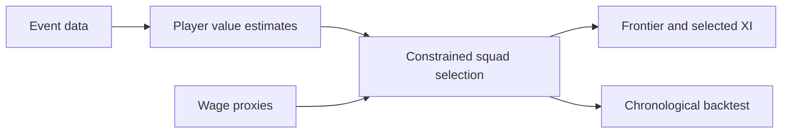

<p align="center"></p>

[](https://github.com/FaiyazEnayet/efficient-frontier-fc/actions/workflows/ci.yml) [](LICENSE)   [](https://faiyazenayet.github.io/efficient-frontier-fc/docs/dashboard.html)

<p align="center"><a href="https://faiyazenayet.github.io/efficient-frontier-fc/docs/dashboard.html"><b>Open interactive demo</b></a> · <a href="#method">Method</a> · <a href="#run-locally">Run locally</a></p>

# Efficient Frontier FC

Efficient Frontier FC treats squad construction as a constrained allocation problem. It combines event-based player value with wage proxies, then asks which feasible 23-player squad fits a specified weekly budget.


[](https://faiyazenayet.github.io/efficient-frontier-fc/docs/dashboard.html)


The frontier is a decision surface rather than a player ranking. Moving the wage budget changes the feasible squad, which in turn changes the best XI and positional tradeoffs. Inspect the selected players and actual wage bill together with the objective, especially because wage proxies and historical rating estimates introduce uncertainty into any recruitment interpretation.

## Explore

- Move between feasible budget points and inspect the actual selected squad and starting XI.
- Read full player names, positional breakdowns and ratings without clipped labels.
- Compare the optimizer with the value benchmark before interpreting the frontier.

## Method

Event-derived player ratings are shrunk and joined to wage proxies. The optimizer applies budget, squad-size and positional constraints. A chronological backtest compares its selections with value, random and hindsight-oracle baselines.

## Evidence at a glance

| Scope | Recorded result or contract |
| :--- | :--- |
| EUR 0.50M weekly cap, second-half squad VAEP/90 | Optimizer 15.98; value baseline 16.37; random 8.04 |
| EUR 0.70M weekly cap, same backtest | Optimizer 13.51; value baseline 16.37; random 9.28 |
| Interpretation | The optimizer beats random but loses to the value baseline at both caps |

## Run locally


```sh
python -m pip install -e ".[dev]"
python -m pip install -r portfolio_ui/requirements.txt
python -m pytest tests -q
python scripts/make_dashboard.py
```

## Technical design

Player value comes from event-derived VAEP-style ratings with shrinkage, rather than manually invented scouting scores. A wage-proxy join supplies the economic constraint. The selection engine enforces the actual squad and positional rules at every budget point, and the dashboard displays those precomputed feasible selections.



## Evaluation protocol

The backtest selects using the earlier part of the season and compares realized later value under common wage caps. The hindsight oracle is a reference bound, not an attainable forecasting policy. A flat frontier means the additional wage budget no longer binds for the modeled objective.


The value-per-euro benchmark beats the optimizer at both reported budgets. The optimizer beats random selection, but that is not enough to claim that added optimization complexity improves squad building. Proxy wages and rating uncertainty remain central limitations.

## Code and data

`src/effc/` contains data joins, ratings, selection and backtesting. `demo/` holds the compact tables used by the dashboard. Rebuilding the full research pipeline additionally requires the source download described in the configuration.


## Limitations

- Wages are EA FC proxies, not verified current player contracts.
- Name-based entity matching needs ambiguity checks and stable player identifiers.
- The pitch arranges the selected XI; it does not simulate tactics or team chemistry.

## License

[MIT](LICENSE). Third-party datasets, libraries and fonts retain their own terms.
