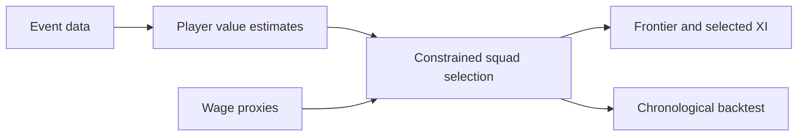
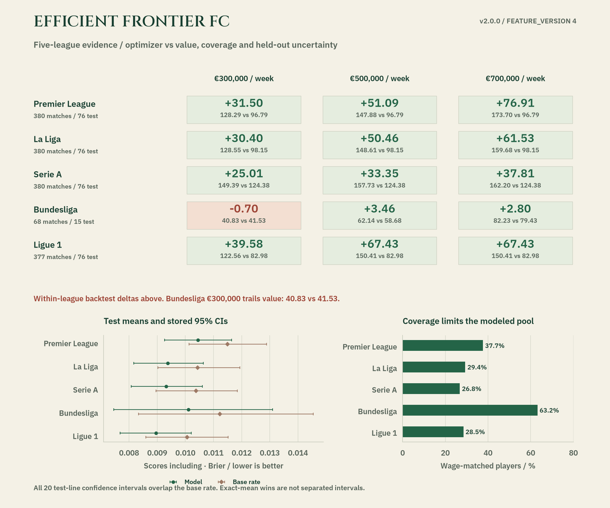

<p align="center"></p>

<h1 align="center">Efficient Frontier FC</h1>

<p align="center">
  <a href="https://github.com/FaiyazEnayet/efficient-frontier-fc/actions/workflows/ci.yml"></a>
  
  
  
</p>

<p align="center">
  <a href="https://faiyazenayet.github.io/efficient-frontier-fc/docs/dashboard.html"></a>
  <a href="#method"></a>
  <a href="#run-locally"></a>
</p>

Efficient Frontier FC treats squad construction as a constrained allocation problem. It combines event-based player value with wage proxies, then asks which feasible 23-player squad fits a specified weekly budget.


<p align="center"><a href="https://faiyazenayet.github.io/efficient-frontier-fc/docs/dashboard.html"></a></p>


The frontier is a decision surface rather than a player ranking. Moving the wage budget changes the feasible squad, which in turn changes the best XI and positional tradeoffs. Inspect the selected players and actual wage bill together with the objective, especially because wage proxies and historical rating estimates introduce uncertainty into any recruitment interpretation.

## Explore

- Move between feasible budget points and inspect the actual selected squad and starting XI.
- Read full player names, positional breakdowns and ratings without clipped labels.
- Compare the optimizer with the value benchmark before interpreting the frontier.

## Method

Event-derived player ratings are shrunk and joined to wage proxies. The optimizer applies budget, squad-size and positional constraints. A chronological backtest compares its selections with value, random and hindsight-oracle baselines.

## Evidence at a glance

| Scope | Recorded result or contract |
| :--- | :--- |
| EUR 0.30M weekly cap, second-half total squad VAEP (unified objective) | Optimizer 37.35; value baseline 35.38; random 7.00 |
| EUR 0.50M weekly cap, same backtest | Optimizer 49.83; value baseline 55.60; random 7.50 |
| EUR 0.70M weekly cap, same backtest | Optimizer 75.92; value baseline 72.09; random 11.44 |
| Interpretation | With the improved goal models (v1.5.0), the optimizer beats the value baseline at the 0.30M and 0.70M caps and trails at 0.50M. Totals are lower than in v1.4.0 at every cap because the pooled, calibrated models produce less extreme VAEP values; the comparison that matters is optimizer vs baseline within the same run. All rules beat random comfortably; the hindsight oracle bounds them from above. |

## Updating this project

Dashboard source language: **Python**. Generator: `scripts/make_dashboard.py`. The local interactive output is `docs/dashboard.html`.

## Run locally


```sh
python -m pip install -e ".[dev]"
python -m pip install -r portfolio_ui/requirements.txt
python -m pytest tests -q
python scripts/make_dashboard.py
```

## Technical design

Player value comes from event-derived VAEP-style ratings with shrinkage, rather than manually invented scouting scores. A wage-proxy join supplies the economic constraint. The selection engine enforces the actual squad and positional rules at every budget point, and the dashboard displays those precomputed feasible selections.



## Evaluation protocol

The backtest selects using the earlier part of the season and compares realized later value under common wage caps. The hindsight oracle is a reference bound, not an attainable forecasting policy. A flat frontier means the additional wage budget no longer binds for the modeled objective.

Goal-model accuracy is measured on held-out matches, never on the training data, and the evaluation protocol is unchanged since v1.4.0: the same 130 training matches, the same 32 held-out matches, the same base-rate baseline, the same season-transfer setup. What changed in v1.5.0 is the model. The training pool grew from 130 matches to 1,813 by pooling other StatsBomb competitions (the full 2015/16 La Liga, Premier League, Serie A and Ligue 1 seasons, UEFA Euro 2020, the 2021/22 Indian Super League, plus the existing World Cup and Bundesliga pool), and the raw gradient-boosting probabilities are Platt-calibrated and lightly shrunk toward the training base rate, with both fitted by chronological cross-fitting on the training matches only. Held-out Brier is now 0.0096 (95% CI 0.0080-0.0113) for scoring and 0.0028 (0.0021-0.0036) for conceding, against the same 0.0113 / 0.0033 base-rate baseline (v1.4.0: 0.0099 / 0.0030). The in-sample Brier (0.0087 / 0.0020) is reported separately and labeled as such. The season-transfer test (train 2015/16 and score 2023/24, with pooled training restricted to the contemporaneous 2015/16 leagues) now beats the baseline on both labels: 0.0097 vs 0.0107 for scoring and 0.00219 vs 0.00222 for conceding, where v1.4.0 lost both (0.0110 vs 0.0107; 0.0023 vs 0.0022). The conceding margin is narrow and the confidence intervals overlap; only 13% of players (24% of minutes) overlap between the seasons. A Dixon-Coles team-strength model was built for this push and is in the codebase (`src/effc/vaep/team_strength.py`), but its features did not beat plain pooling on internal validation, so the shipped models do not use them; per-configuration validation scores are in `runs/beat_baseline/results.json`.



The optimizer beats the value-per-euro benchmark at two of the three reported budgets and trails at the middle one, so the evidence that added optimization complexity improves squad building is mixed rather than decisive. Proxy wages and rating uncertainty remain central limitations.

## Code and data

`src/effc/` contains data joins, ratings, selection and backtesting. `demo/` holds the compact tables used by the dashboard. Rebuilding the full research pipeline additionally requires the source download described in the configuration.


## Limitations

- Wages are EA FC proxies, not verified current player contracts.
- Name-based entity matching needs ambiguity checks and stable player identifiers.
- The pitch arranges the selected XI; it does not simulate tactics or team chemistry.

## License

[MIT](LICENSE). Third-party datasets, libraries and fonts retain their own terms.
