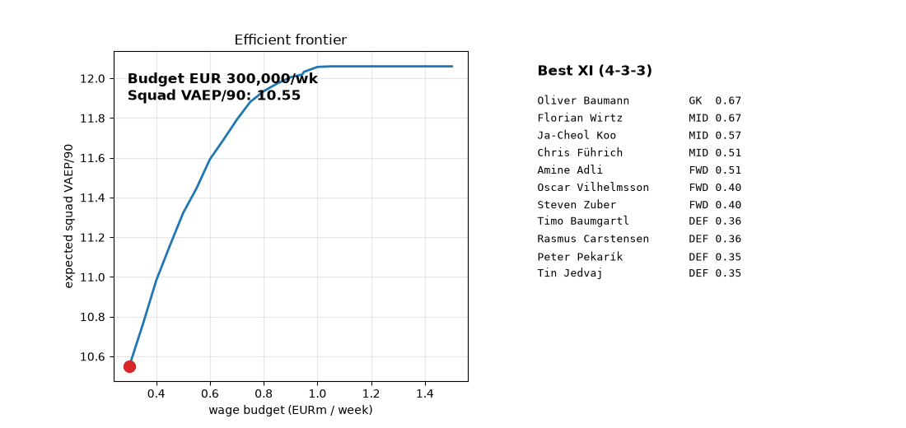
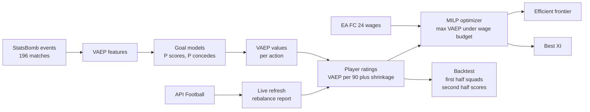

# Efficient Frontier FC


[](https://faiyazenayet.github.io/efficient-frontier-fc/docs/dashboard.html)

**Squad building as portfolio optimization.** Players are assets, expected on ball value is the return, the weekly wage is the cost. Integer programming builds the best squad at each budget. The result is an efficient frontier for football.

I kept noticing that football analytics stops at describing players (xG, ratings, radars) and never does the thing finance does with asset estimates: optimize under constraints. So I built the missing step. Estimate value honestly, then ask the optimizer what the best team money can buy looks like, and check whether it holds up out of sample.

```python
from effc.portfolio.portfolio import efficient_frontier, select_squad
import numpy as np

budgets = np.array([300_000, 500_000, 700_000, 943_000, 1_500_000])
frontier = efficient_frontier(ratings, budgets)  # MILP per budget
```

## Live interactive demo

[Open docs/dashboard.html](https://faiyazenayet.github.io/efficient-frontier-fc/docs/dashboard.html) in a browser. It is one self contained HTML file with everything inlined, so it works straight off disk and from GitHub Pages later. No install, no server. Drag the budget slider and the frontier marker, the 23 man squad table, and the best XI all update at each step. Below that: top rated players with a position filter, and the backtest across selection rules. Regenerate it any time with `python scripts/make_dashboard.py`.



## Architecture



## What came out

Bundesliga 2023/24 and 2015/16, seed 0. Rerun `python -m effc.pipeline configs/bundesliga_2seasons.yaml` and check my work.

Top rated: Baumann 0.67, Wirtz 0.67, Mathenia 0.66 (VAEP/90, shrunk). Among outfielders the names are familiar: Wirtz 0.67, Frimpong 0.61, Grimaldo 0.58, and the unbeaten 23/24 champions still dominate the list.


The efficient frontier:

| wage budget/week | expected squad VAEP/90 |
|---|---|
| EUR 0.30M | 9.99 |
| EUR 0.50M | 10.76 |
| EUR 0.70M | 11.32 |
| EUR 0.94M | 11.62 |
| EUR 1.50M | 11.67 |

Diminishing returns, then flat. Past ~0.94M/week the budget stops binding: 11.62 at 0.94M, 11.67 at 1.50M. The best XI (4-3-3) costs EUR 569k/week. The optimal squad here is a Moneyball squad. The flat top is a result, not a bug.


The backtest (realized second half squad VAEP/90):

| budget/week | optimizer | value | random | oracle |
|---|---|---|---|---|
| EUR 0.50M | 15.98 | 16.37 | 8.04 | 17.34 |
| EUR 0.70M | 13.51 | 16.37 | 9.28 | 16.87 |

The optimizer beats random out of sample at both budgets and sits below the oracle, which gets to see the second half. The value benchmark beats the optimizer at both budgets. I give that a closer look in Honest limitations below.


## How it works

**Value every touch (VAEP).** 362k on ball actions from 162 matches of StatsBomb event data. Two gradient boosted models learn P(team scores) and P(team concedes) in the next 10 actions from the game state. An action's value is the change it causes, plus 1 for a scored goal, minus 1 for a conceded one. The two label windows are asymmetric on purpose: the "before" window includes the current action so chances count, the "after" window excludes it so a scored goal does not poison the state that follows. Getting this wrong gives goals zero value or keepers infinite value. I got it wrong twice.

**Turn it into ratings.** Sum VAEP per player, divide by minutes, shrink toward position group means (90 minutes of brilliance does not make you the best in the league). 268 rated players across Bundesliga 2023/24 and 2015/16.

**Price them.** EA FC 24 weekly wages, joined by normalized name matching.

**Optimize.** Binary portfolio: sign the player or do not. Maximize expected squad VAEP subject to wage budget, a 23 player squad, and position quotas. One MILP per budget point.

**Backtest.** Split each season in half by date and pool the halves. Ratings and squads from the first halves only, scored on the second halves. Every rule is the same constrained selection problem with a different objective: the optimizer maximizes expected VAEP, value maximizes VAEP per euro, random maximizes random weights, and the oracle re-runs the optimizer on second-half ratings. Same quotas, same wage budget, so the only difference is the selection rule.

## Data

- Events: StatsBomb open data (free). 162 matches pooled for the goal models (Bundesliga 23/24 and 15/16 first halves, World Cups 2018 and 2022); ratings on Bundesliga 2023/24 and 2015/16, 34 matches per season.
- Wages: EA FC 24 database (mzafram2001/ea-fc, open source), weekly wages in EUR.
- `python -m effc.data.download` fetches everything into `data/` (gitignored, ~600MB).

## Reproduce

```bash
pip install -e ".[dev]"
python -m effc.data.download   # one time, ~10 min
python -m effc.pipeline configs/bundesliga_2seasons.yaml
pytest                        # 27 tests
```

The dashboard and its preview are generated from small derived tables, no download needed:

```bash
python scripts/make_demo.py       # demo/*.csv from the pipeline caches
python scripts/make_dashboard.py  # docs/dashboard.html
python scripts/make_gif.py        # docs/demo.gif
```

## Live refresh

A squad is a portfolio, so it should rebalance when new information arrives. `python -m effc.live_refresh` pulls finished fixtures from API-Football, turns match events into per player value proxies, folds them into the ratings, reruns the optimizer, and prints who enters and leaves the squad:

```bash
python -m effc.live_refresh --league 78 --season 2024 --budget 700000
```

The proxy turns goals, assists, and cards into value on the VAEP scale (a goal moves P(score) from ~0.1 to 1.0, hence 0.9) and blends into ratings with a half-life curve, so a hot week moves the needle without rewriting a season. The free tier covers seasons 2022 to 2024 with about 2 days of date history and 100 requests per day. One daily refresh of a 9 fixture matchday costs about 20 calls. Get a free key at api-football.com and set `API_FOOTBALL_KEY`.

## Honest limitations

- 68 Bundesliga matches across two seasons. Better than 34, still thin. Ratings lean on shrinkage, and the backtest halves are 34 matches each (17 per season, pooled). More data would tighten everything.
- The naive value benchmark beats the optimizer out of sample at both budgets: 16.37 vs 15.98 at 500k and 16.37 vs 13.51 at 700k. That loss is real and I am not hiding it. Once every baseline plays under the same wage cap, value per euro beats the risk blind MILP. The optimizer still beats random clearly. I removed the stars baseline in the process: with the risk penalty off, the optimizer already maximizes raw VAEP/90, so an exact stars rule solves the identical problem and returns the identical squad. Keeping it would have printed one squad twice. The random baseline is now built by maximizing random weights under the same constraints, since rejection sampling could not reach the tight budgets.
- Keepers top the rating list (Baumann 0.67, Mathenia 0.66). That says more about VAEP than about scouting: clean sheets and saves pile up value quietly.
- Wages are video game wages. They correlate with real wages but they are not real wages. FC 24 has no row for most 2015/16 players. The name match hits 63% and the misses get dropped. FC 24 wages are applied to both seasons, including 2015/16 players whose actual pay that year looked nothing like these numbers. The framework does not care where the cost vector comes from, but the euro figures for the older season are fiction.
- No chemistry, no injuries, no tactics. A squad is not 23 independent assets and I know it. The factor covariance model is a start, not an answer.
- No free feed publishes live event data, so true live VAEP is impossible without a paid feed. The live refresh proxy is a starting point, not science.
- CPU only, two seasons, one league.

## Reference

Decroos et al., *"Actions Speak Louder than Goals: Valuing Player Actions in Soccer"*, KDD 2019. The VAEP framework this builds on.

Issues and PRs welcome. If you run it on a full season, tell me where the frontier moves.
